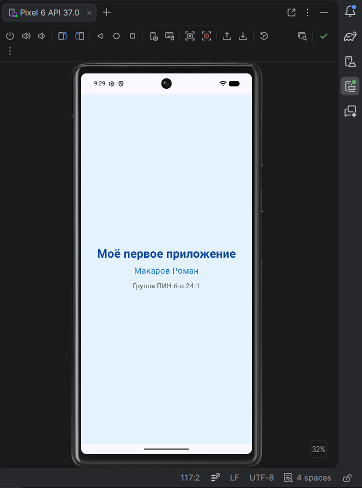

# **Отчет по лабораторной работе №1: «Установка среды разработки и запуск первого мобильного приложения на Jetpack Compose»**

## **Сведения о студенте**

**Дата:** 2026-10-18  
**Семестр:** 3 курс, 5 семестр  
**Группа:** ПИН-б-о-24-1  
**Дисциплина:** Программирование мобильных устройств  
**Студент:** Макаров Роман Дмитриевич

### **Ссылка на репозиторий GitHub**

```
https://github.com/drrrm471/PIN_MakarovRD_Mobile
```

### **Структура каталога работы**

```
lab0102/
├── MainActivity.kt          # Исходный код приложения (весь UI на Jetpack Compose)
├── README.md                # Отчет по лабораторной работе
└── screenshots/
    └── main_screen.png      # Скриншот приложения на эмуляторе
```

### **1. ЦЕЛЬ РАБОТЫ**

> 1. Установить и настроить среду разработки для Android-приложений (Android Studio).
> 2. Создать и запустить первое мобильное приложение на **Jetpack Compose**.
> 3. Освоить базовую навигацию в Android Studio и структуру Compose-проекта.
> 4. Создать удалённый репозиторий на GitHub и загрузить проект.

### **2. ЗАДАЧИ РАБОТЫ**

**Выполнены следующие задачи:**

> 1. Установка Android Studio (последняя стабильная версия) с официального сайта developer.android.com/studio.
> 2. Использование JDK, встроенного в Android Studio (JetBrains Runtime); JVM toolchain проекта — 25.
> 3. Установка компонентов Android SDK через мастер первоначальной настройки и SDK Manager: SDK Platform, Emulator, Build-Tools, Platform-Tools.
> 4. Создание виртуального устройства Pixel 6 и проверка его запуска.
> 5. Создание проекта по шаблону **Empty Activity** (Compose): Kotlin, minSdk 24, Kotlin DSL.
> 6. Изучение структуры Compose-проекта: отсутствие XML-разметки экрана, весь UI в `MainActivity.kt`.
> 7. Модификация UI: заголовок «Моё первое приложение», имя и группа студента, цвета текста и фона, отступы через `Modifier`.
> 8. Документирование класса и всех `@Composable`-функций KDoc-комментариями.
> 9. Запуск приложения на эмуляторе и проверка через `@Preview`.
> 10. Публикация отчёта, исходного кода `MainActivity.kt` и скриншота в публичном репозитории дисциплины на GitHub.

### **3. ХОД ВЫПОЛНЕНИЯ РАБОТЫ**

**Окружение:** Windows, Android Studio (последняя стабильная версия), эмулятор Pixel 6 (Android API 37), Git for Windows, платформа github.com.

#### **3.1. Установка Android Studio и JDK**

Android Studio скачана с официального сайта developer.android.com/studio и установлена через мастер установки. Отдельная установка JDK не потребовалась: в состав Android Studio входит JetBrains Runtime, которым IDE и Gradle пользуются по умолчанию. Версия JVM toolchain для сборки проекта задана в файле `gradle/gradle-daemon-jvm.properties`:

```
toolchainVersion=25
```

#### **3.2. Настройка Android SDK**

При первом запуске мастер настройки (Setup Wizard) в режиме **Standard** установил базовые компоненты SDK. Состав проверен в **Tools → SDK Manager**:

| Вкладка | Компонент |
|:---|:---|
| SDK Platforms | Android SDK Platform (API 37) |
| SDK Tools | Android SDK Build-Tools |
| SDK Tools | Android Emulator |
| SDK Tools | Android SDK Platform-Tools |

- **SDK Platform** — библиотеки Android конкретной версии API, под которую компилируется приложение;
- **Build-Tools** — инструменты сборки APK;
- **Emulator** — виртуальное Android-устройство;
- **Platform-Tools** — утилиты связи с устройством (`adb`).

#### **3.3. Создание эмулятора**

Виртуальное устройство создано в **Device Manager** (**Tools → Device Manager → Create Device**):

| Параметр | Значение |
|:---|:---|
| Device | Pixel 6 |
| System Image | Android API 37 |
| Имя AVD | Pixel 6 API 37.0 |

Эмулятор успешно запускается кнопкой ▶ в Device Manager и отображается в списке устройств на панели запуска.

#### **3.4. Создание Compose-проекта**

**File → New → New Project → Phone and large screens → Empty Activity.** Выбран шаблон Empty Activity с поддержкой Compose (шаблон «Empty Views Activity» относится к устаревшей XML-вёрстке).

| Параметр | Значение |
|:---|:---|
| Name | Hello |
| Package name | `com.example.hello` |
| Save location | `C:\Users\MSI\Documents\Projects\Working\mobile\lab0102` |
| Minimum SDK | API 24 ("Nougat"; Android 7.0), ~99,2 % устройств |
| Build configuration language | Kotlin DSL (`build.gradle.kts`) |

После создания Android Studio выполнила синхронизацию Gradle и загрузила зависимости. Версии из конфигурации проекта:

| Компонент | Версия |
|:---|:---|
| Android Gradle Plugin | 9.4.1 |
| Gradle Wrapper | 9.6.0 |
| Kotlin / Compose compiler plugin | 2.2.10 |
| Compose BOM | 2026.02.01 |
| compileSdk / targetSdk | 37 |
| minSdk | 24 |

#### **3.5. Изучение структуры Compose-проекта**

- `app/src/main/java/com/example/hello/MainActivity.kt` — точка входа и весь интерфейс;
- `app/src/main/java/com/example/hello/ui/theme/` — тема приложения: `Color.kt` (цвета), `Theme.kt` (функция `HelloTheme`), `Type.kt` (типографика);
- `app/src/main/AndroidManifest.xml` — регистрация `MainActivity` как стартового экрана;
- `app/build.gradle.kts` — параметры SDK и зависимости Compose (`compose-bom`, `material3`, `ui`, `ui-tooling-preview`, `activity-compose`);
- `gradle/libs.versions.toml` — каталог версий библиотек.

Каталог `res/layout/` в проекте **отсутствует**: разметка экрана описывается Kotlin-кодом через `@Composable`-функции.

#### **3.6. Модификация UI**

За основу взят шаблон `MainActivity.kt` из задания. Доработки выполнены по пунктам `TODO`:

- текст `"Hello $name!"` заменён на `"Моё первое приложение"`;
- добавлено второе текстовое поле с именем и третье — с группой (в `Greeting` добавлен параметр `group`);
- с помощью `Modifier` заданы цвет фона, размеры и отступы, у текстов — цвет и размер шрифта;
- в `onCreate` вызов `Greeting("Android")` заменён на вызов с данными студента.

Вызов в `onCreate` (обёртка `Surface` из шаблона сохранена):

```kotlin
setContent {
    HelloTheme {
        Surface(
            modifier = Modifier.fillMaxSize(),
            color = MaterialTheme.colorScheme.background
        ) {
            Greeting(
                name = "Макаров Роман",
                group = "Группа ПИН-б-о-24-1"
            )
        }
    }
}
```

Доработанная функция `Greeting`:

```kotlin
@Composable
fun Greeting(name: String, group: String, modifier: Modifier = Modifier) {
    Column(
        modifier = modifier
            .fillMaxSize()
            .background(Color(0xFFE3F2FD))
            .padding(24.dp),
        verticalArrangement = Arrangement.spacedBy(12.dp, Alignment.CenterVertically),
        horizontalAlignment = Alignment.CenterHorizontally
    ) {
        Text(
            text = "Моё первое приложение",
            fontSize = 28.sp,
            fontWeight = FontWeight.Bold,
            color = Color(0xFF0D47A1)
        )
        Text(
            text = name,
            fontSize = 20.sp,
            color = Color(0xFF1976D2)
        )
        Text(
            text = group,
            fontSize = 16.sp,
            color = Color.DarkGray
        )
    }
}
```

Использованные элементы:

| Элемент | Назначение |
|:---|:---|
| `Surface` | Контейнер из шаблона: занимает весь экран, фон из темы `MaterialTheme.colorScheme.background` |
| `Column` | Вертикальное размещение элементов |
| `Text` | Вывод текста; параметры `fontSize`, `fontWeight`, `color` |
| `Modifier.fillMaxSize()` | Занять весь доступный размер |
| `Modifier.background(Color(0xFFE3F2FD))` | Светло-голубой фон экрана |
| `Modifier.padding(24.dp)` | Внутренний отступ 24 dp |
| `Arrangement.spacedBy(12.dp, Alignment.CenterVertically)` | Промежуток 12 dp между элементами, группа по центру по вертикали |
| `Alignment.CenterHorizontally` | Центрирование по горизонтали |
| `Color(0xFF0D47A1)` | Цвет в формате ARGB: `FF` — непрозрачность, `0D47A1` — RGB |
| `dp` / `sp` | Единицы размеров и отступов / размера шрифта |

Порядок модификаторов имеет значение: `background` указан до `padding`, поэтому фон закрашивает всю область, включая отступ.

#### **3.7. Документирование кода (KDoc)**

Класс `MainActivity`, метод `onCreate` и все `@Composable`-функции (`Greeting`, `GreetingPreview`) снабжены KDoc-комментариями с описанием назначения, параметров (`@param`), автора (`@author`), версии (`@version`) и даты (`@since`):

```kotlin
/**
 * Composable-функция, отображающая приветствие, имя и группу пользователя.
 *
 * @param name Имя пользователя.
 * @param group Группа пользователя.
 * @param modifier Модификатор для настройки внешнего вида.
 *
 * @author Макаров Роман (ПИН-б-о-24-1)
 * @since 2026-10-18
 */
```

#### **3.8. Запуск приложения на эмуляторе**

Конфигурация `app` запущена на устройстве **Pixel 6 API 37.0** кнопкой **Run 'app'** (`Shift+F10`). Изменения отображаются корректно, совпадают с окном предпросмотра `@Preview`.

<div align="center">

</div>

#### **3.9. Публикация проекта на GitHub**

Работы по дисциплине размещаются в одном репозитории `PIN_MakarovRD_Mobile`: в корне — общий `README.md`, в `other/` — план дисциплины и задания, в каталогах `labXXXX/` — материалы лабораторных работ. В каталог `lab0102/` помещены только отчёт, исходный файл `MainActivity.kt` и скриншот; полный проект Android Studio хранится локально в каталоге `C:\Users\MSI\Documents\Projects\Working\mobile\lab0102`.

**Инициализация репозитория.**

```bash
cd C:\Users\MSI\Documents\Projects\Working\mobile\PIN_MakarovRD_Mobile
git init
git status
```

Вывод команд в терминале:

```
C:\Users\MSI\Documents\Projects\Working\mobile\PIN_MakarovRD_Mobile>git init
Initialized empty Git repository in C:/Users/MSI/Documents/Projects/Working/mobile/PIN_MakarovRD_Mobile/.git/

C:\Users\MSI\Documents\Projects\Working\mobile\PIN_MakarovRD_Mobile>git status
On branch main

No commits yet

Untracked files:
  (use "git add <file>..." to include in what will be committed)
        README.md
        lab0102/
        other/

nothing added to commit but untracked files present (use "git add" to track)
```

Команда `git init` создала локальную базу данных репозитория (каталог `.git`). Ветка называется `main` благодаря глобальной настройке `init.defaultBranch`. Все файлы находятся в состоянии *Untracked* — Git их видит, но ещё не отслеживает.

**Коммит 1 — описание репозитория, план и задания.**

```bash
git add README.md other/
git commit -m "docs: add course plan, lab tasks and repository README"
```

Вывод команд в терминале:

```
[main (root-commit) c0c5570] docs: add course plan, lab tasks and repository README
 11 files changed, 6700 insertions(+)
 create mode 100644 README.md
 create mode 100644 other/plan/0000_plan.md
 create mode 100644 other/tasks/0102_lab.md
 create mode 100644 other/tasks/0202_lab.md
 create mode 100644 other/tasks/0302_lab.md
 create mode 100644 other/tasks/0402_lab.md
 create mode 100644 other/tasks/0502_lab.md
 create mode 100644 other/tasks/0602_lab.md
 create mode 100644 other/tasks/0702_lab.md
 create mode 100644 other/tasks/0802_lab.md
 create mode 100644 other/tasks/0902_lab.md
```

Пометка `root-commit` означает первый коммит в истории (без родителя). Префикс `docs:` по соглашению Conventional Commits обозначает изменения документации.

**Коммит 2 — материалы лабораторной работы.**

```bash
git add lab0102/
git commit -m "add lab0102"
```

Вывод команд в терминале:

```
[main 3d9c827] add lab0102
 3 files changed, 433 insertions(+)
 create mode 100644 lab0102/MainActivity.kt
 create mode 100644 lab0102/README.md
 create mode 100644 lab0102/screenshots/main_screen.png
```

В коммит вошли исходный код `MainActivity.kt`, отчёт и скриншот приложения.

**Просмотр истории коммитов.**

```bash
git log --oneline
```

Вывод команды в терминале:

```
3d9c827 (HEAD -> main) add lab0102
c0c5570 docs: add course plan, lab tasks and repository README
```

Команда открыла вывод в постраничном просмотрщике `less` (стандартное поведение Git for Windows); выход из просмотра — клавиша `q`.

**Создание удалённого репозитория и отправка изменений.**

На GitHub создан пустой публичный репозиторий `PIN_MakarovRD_Mobile` (**New repository**, без инициализации файлами README и `.gitignore` — иначе на сервере появился бы собственный первый коммит, не связанный с локальной историей).

```bash
git remote add origin https://github.com/drrrm471/PIN_MakarovRD_Mobile.git
git remote -v
git push -u origin main --force
```

Вывод команды `git remote -v`:

```
origin  https://github.com/drrrm471/PIN_MakarovRD_Mobile.git (fetch)
origin  https://github.com/drrrm471/PIN_MakarovRD_Mobile.git (push)
```

Удалённый репозиторий добавлен под стандартным именем `origin` по HTTPS-адресу. Ключ `-u` связал локальную ветку `main` с `origin/main`, поэтому далее достаточно команды `git push`. Ключ `--force` использован потому, что репозиторий на GitHub был пересоздан с новой историей: принудительная отправка заменяет историю на сервере локальной.

Проверка связи веток:

```bash
git branch -vv
```

```
* main 3d9c827 [origin/main] add lab0102
```

Метка `[origin/main]` показывает, что локальная ветка `main` отслеживает удалённую и изменения отправлены на GitHub.

**Ссылка на репозиторий:** [github.com/drrrm471/PIN_MakarovRD_Mobile](https://github.com/drrrm471/PIN_MakarovRD_Mobile)

### **4. ОТВЕТЫ НА КОНТРОЛЬНЫЕ ВОПРОСЫ**

#### **1. Что такое Jetpack Compose и в чём его отличие от XML-вёрстки?**

Jetpack Compose — современный декларативный UI-фреймворк Google для Android. В XML-подходе разметка описывается в отдельных layout-файлах, а код находит элементы (`findViewById`) и вручную меняет их свойства — это императивный стиль. В Compose интерфейс описывается функциями на Kotlin как функция от состояния: при изменении данных Compose сам перестраивает нужные части экрана. UI и логика находятся в одном языке, шаблонного кода значительно меньше.

| Критерий | XML + View | Jetpack Compose |
|:---|:---|:---|
| Подход | Императивный | Декларативный |
| Код | XML + Kotlin/Java | Только Kotlin |
| Обновление UI | Вручную (`setText`, `setVisibility`) | Автоматическая рекомпозиция |
| Layout-файлы | Обязательны | Отсутствуют |

#### **2. Что такое `@Composable`-функция? Чем она отличается от обычной функции?**

Функция с аннотацией `@Composable`, описывающая часть интерфейса. Она не возвращает View, а «излучает» элементы в дерево UI; вызывать её можно только из другой `@Composable`-функции или из `setContent`. Компилятор Compose добавляет в неё служебный параметр `Composer`, благодаря чему функция участвует в рекомпозиции — Compose может повторно вызвать её при изменении данных. Обычная функция просто выполняет вычисление и с деревом UI не связана. В работе это `Greeting` и `GreetingPreview`.

#### **3. Что такое `Modifier` и для чего он используется? Приведите примеры.**

`Modifier` — неизменяемая цепочка настроек внешнего вида и поведения элемента: размеры, отступы, фон, рамки, форма, обработка нажатий. Модификаторы вызываются через точку, и порядок важен. Примеры из работы: `Modifier.fillMaxSize()` — растянуть на весь экран, `.background(Color(0xFFE3F2FD))` — фон, `.padding(24.dp)` — отступ. Другие примеры: `size(100.dp)`, `clip(CircleShape)`, `border(2.dp, Color.Gray)`, `clickable { }`.

#### **4. Что такое рекомпозиция и как она работает в Compose?**

Рекомпозиция — повторный вызов `@Composable`-функций при изменении состояния, которое они читают. Compose отслеживает, какая функция какие данные использует, и при их изменении перезапускает только затронутые функции, а не весь экран. Так интерфейс автоматически остаётся согласованным с данными без ручного обновления элементов.

#### **5. Для чего нужна аннотация `@Preview`?**

Для отображения `@Composable`-функции в окне предпросмотра Android Studio (режимы Split/Design) без сборки и запуска на эмуляторе. Это ускоряет вёрстку. Параметры: `showBackground = true` — рисовать фон, `name`, `device`, `uiMode`, `locale` — разные конфигурации. В работе — функция `GreetingPreview`. Функция с `@Preview` используется только в IDE и на устройстве не выполняется.

#### **6. Почему Google рекомендует использовать Jetpack Compose вместо XML?**

- меньше кода: нет layout-файлов и `findViewById`;
- меньше ошибок: состояние и UI связаны автоматически, нет рассинхронизации и `NullPointerException` из-за разметки;
- декларативность упрощает чтение и тестирование;
- полная интеграция с Kotlin (лямбды, корутины, null-безопасность);
- готовые компоненты Material 3, анимации, темы;
- Compose — основной развиваемый инструментарий UI для Android, XML поддерживается как легаси.

#### **7. Какова структура Compose-проекта?**

Модуль `app` содержит `AndroidManifest.xml`, Kotlin-код в `java/<пакет>/` и ресурсы в `res/`. Весь интерфейс описывается в Kotlin-файлах (`MainActivity.kt`), каталог `res/layout/` отсутствует. Тема вынесена в пакет `ui/theme/` (`Color.kt`, `Theme.kt`, `Type.kt`). Сборка описывается файлами `build.gradle.kts` (корневой и модуля), `settings.gradle.kts` и каталогом версий `gradle/libs.versions.toml`.

#### **8. Что такое `State` и `remember` в Compose?**

`State` — наблюдаемый контейнер значения (`mutableStateOf(...)`): при изменении значения Compose выполняет рекомпозицию функций, которые его читают. `remember` сохраняет объект между рекомпозициями; без него при каждом повторном вызове функции состояние создавалось бы заново.

```kotlin
var count by remember { mutableStateOf(0) }
Button(onClick = { count++ }) {
    Text("Нажато: $count")
}
```

### **5. ИСПОЛЬЗУЕМЫЕ КОМАНДЫ И ДЕЙСТВИЯ**

```
# Android Studio
Tools → SDK Manager                        # проверка компонентов SDK
Tools → Device Manager → Create Device     # создание эмулятора Pixel 6
File → New → New Project → Empty Activity  # создание Compose-проекта
Run 'app' (Shift+F10)                      # сборка и запуск на эмуляторе
Split / Design → Build & Refresh           # предпросмотр @Preview
```

```bash
# Локальный репозиторий
git init
git status
git add README.md other/
git commit -m "docs: add course plan, lab tasks and repository README"
git add lab0102/
git commit -m "add lab0102"
git log --oneline

# Удалённый репозиторий
git remote add origin https://github.com/drrrm471/PIN_MakarovRD_Mobile.git
git remote -v
git push -u origin main --force
```

### **6. ВЫВОДЫ**

> 1. Установлена и настроена среда разработки Android: Android Studio со встроенным JDK, компоненты Android SDK и эмулятор Pixel 6 (API 37).
> 2. Создан проект по шаблону Empty Activity на Jetpack Compose (Kotlin, minSdk 24, Kotlin DSL); изучена его структура и отличие от XML-подхода — отсутствие layout-файлов.
> 3. Разобраны назначение `ComponentActivity`, `onCreate`, `setContent`, темы `HelloTheme`, контейнера `Surface`.
> 4. Модифицирован интерфейс: заголовок, имя и группа студента выведены в `Column`, заданы размеры шрифта, цвета текста и фона, отступы и выравнивание через `Modifier`, `Arrangement` и `Alignment`.
> 5. Код задокументирован KDoc-комментариями; приложение запущено на эмуляторе и проверено через `@Preview`.
> 6. Создан репозиторий дисциплины `PIN_MakarovRD_Mobile` на GitHub; в него загружены отчёт, исходный код `MainActivity.kt` и скриншот работающего приложения.
