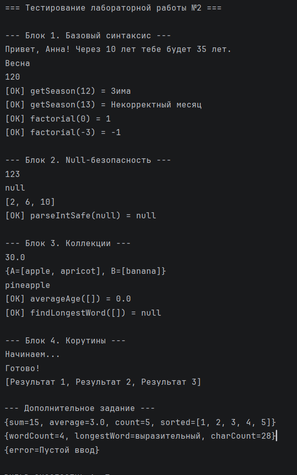

# **Отчет по лабораторной работе №2: «Основы языка Kotlin. Решение задач»**

## **Сведения о студенте**

**Дата:** 2026-11-17  
**Семестр:** 3 курс, 5 семестр  
**Группа:** ПИН-б-о-24-1  
**Дисциплина:** Программирование мобильных устройств  
**Студент:** Макаров Роман Дмитриевич

### **Ссылка на репозиторий GitHub**

```
https://github.com/drrrm471/PIN_MakarovRD_Mobile
```

### **Структура каталога работы**

```
lab0202/
├── Main.kt              # Точка входа, тестирование функций
├── BasicSyntax.kt       # Задачи блока 1 (1.1–1.3)
├── NullSafety.kt        # Задачи блока 2 (2.1–2.2)
├── Collections.kt       # Задачи блока 3 (3.1–3.3)
├── Coroutines.kt        # Задачи блока 4 (4.1–4.2)
├── DataClasses.kt       # Data class Person
├── AdditionalTask.kt    # Дополнительное задание
├── TestUtils.kt         # Вспомогательные функции для тестирования
├── README.md            # Отчет по лабораторной работе
└── screenshots/
    └── run_result.png   # Скриншот результата запуска
```

### **1. ЦЕЛЬ РАБОТЫ**

> 1. Закрепить базовый синтаксис языка Kotlin.
> 2. Научиться работать с **null-безопасностью**, коллекциями и функциями высшего порядка.
> 3. Освоить основы **корутин (Coroutines)** для асинхронного программирования.
> 4. Применить полученные знания для решения практических задач.
> 5. Подготовить проект к интеграции с Android-приложением (Kotlin/JVM).

### **2. ЗАДАЧИ РАБОТЫ**

**Выполнены следующие задачи:**

> 1. Создание проекта `kotlin-tasks` (Kotlin/JVM, Gradle Kotlin DSL) со структурой из шаблона.
> 2. Реализация задач блока 1 «Базовый синтаксис»: `greetUser`, `getSeason`, `factorial`.
> 3. Реализация задач блока 2 «Null-безопасность»: `parseIntSafe`, `filterNonNullAndDouble`.
> 4. Реализация задач блока 3 «Коллекции и функции высшего порядка»: `averageAge`, `groupByFirstLetter`, `findLongestWord`.
> 5. Реализация задач блока 4 «Корутины»: `delayedPrint`, `runParallelTasks`.
> 6. Реализация дополнительного задания `processUserInput`.
> 7. Заполнение KDoc-комментариев (автор, дата, примеры).
> 8. Тестирование всех задач в функции `main()` и запуск программы.

### **3. ХОД ВЫПОЛНЕНИЯ РАБОТЫ**

**Окружение:** Windows, Android Studio, Kotlin/JVM, Gradle (Kotlin DSL), библиотека `kotlinx-coroutines-core`.

#### **3.1. Настройка среды**

Методичка допускает выполнение работы в Kotlin Playground или в локальной среде (IntelliJ IDEA / Android Studio). Использована Android Studio, установленная в ЛР №1: она основана на IntelliJ IDEA и открывает Kotlin/JVM-проекты на Gradle. Компилятор Kotlin отдельно не устанавливается — его подключает Gradle-плагин `kotlin("jvm")`.

#### **3.2. Создание проекта**

Проект `kotlin-tasks` создан со структурой из шаблона:

```
kotlin-tasks/
├── src/main/kotlin/
│   ├── Main.kt
│   ├── tasks/
│   │   ├── BasicSyntax.kt
│   │   ├── NullSafety.kt
│   │   ├── Collections.kt
│   │   ├── Coroutines.kt
│   │   ├── DataClasses.kt
│   │   └── AdditionalTask.kt
│   └── utils/
│       └── TestUtils.kt
├── build.gradle.kts
└── settings.gradle.kts
```

Файлы задач скопированы из шаблона методички. Дополнительное задание вынесено в отдельный файл `tasks/AdditionalTask.kt`.

Конфигурация сборки `build.gradle.kts`:

```kotlin
import org.jetbrains.kotlin.gradle.dsl.JvmTarget

plugins {
    kotlin("jvm") version "2.2.10"
    application
}

repositories {
    mavenCentral()
}

dependencies {
    implementation("org.jetbrains.kotlinx:kotlinx-coroutines-core:1.10.2")
}

java {
    sourceCompatibility = JavaVersion.VERSION_21
    targetCompatibility = JavaVersion.VERSION_21
}

kotlin {
    compilerOptions {
        jvmTarget.set(JvmTarget.JVM_21)
    }
}

application {
    mainClass.set("MainKt")
}

tasks.withType<JavaExec>().configureEach {
    jvmArgs("-Dstdout.encoding=UTF-8", "-Dstderr.encoding=UTF-8")
}
```

- `kotlin("jvm")` — компиляция Kotlin под JVM;
- `application` — запуск программы командой `gradlew run`;
- `kotlinx-coroutines-core` — библиотека корутин (`async`, `delay`, `runBlocking`), без неё блок 4 не скомпилируется;
- блоки `java` и `kotlin` задают одинаковую целевую версию JVM 21 для Java и Kotlin. Без них сборка падала с ошибкой `Inconsistent JVM Target Compatibility`: Gradle работает на JDK 25, а Kotlin 2.2.10 поддерживает целевую версию не выше 24;
- `mainClass = "MainKt"` — функция `main()` из файла `Main.kt` компилируется в класс `MainKt`.
- `-Dstdout.encoding=UTF-8` — вывод программы в кодировке UTF-8. Без этого в Windows консоль Android Studio показывала вместо русских букв символы `�`.

#### **3.3. Блок 1. Базовый синтаксис — `BasicSyntax.kt`**

```kotlin
package tasks

/**
 * Блок задач по базовому синтаксису Kotlin.
 *
 * @author Макаров Роман (ПИН-б-о-24-1)
 * @version 1.0
 * @since 2026-11-17
 */
object BasicSyntax {

    /**
     * Задача 1.1. Приветствие пользователя.
     *
     * Возвращает строку с приветствием и возрастом через 10 лет.
     *
     * @param name Имя пользователя.
     * @param age Текущий возраст.
     * @return Строка с приветствием.
     *
     * Пример: greetUser("Анна", 25) -> "Привет, Анна! Через 10 лет тебе будет 35 лет."
     */
    fun greetUser(name: String, age: Int): String {
        return "Привет, $name! Через 10 лет тебе будет ${age + 10} лет."
    }

    /**
     * Задача 1.2. Определение времени года по номеру месяца.
     *
     * @param month Номер месяца (1–12).
     * @return Название времени года или "Некорректный месяц".
     *
     * Пример: getSeason(3) -> "Весна"
     */
    fun getSeason(month: Int): String {
        return when (month) {
            12, 1, 2 -> "Зима"
            3, 4, 5 -> "Весна"
            6, 7, 8 -> "Лето"
            9, 10, 11 -> "Осень"
            else -> "Некорректный месяц"
        }
    }

    /**
     * Задача 1.3. Вычисление факториала (рекурсия).
     *
     * @param n Число (≥ 0).
     * @param accumulator Накопленное произведение (по умолчанию 1).
     * @return Факториал числа или -1 для отрицательных значений.
     *
     * Пример: factorial(5) -> 120
     */
    tailrec fun factorial(n: Int, accumulator: Long = 1L): Long {
        if (n < 0) return -1
        if (n <= 1) return accumulator
        return factorial(n - 1, accumulator * n)
    }
}
```

- **`greetUser`** — строковый шаблон: `$name` подставляет переменную, `${age + 10}` — результат выражения.
- **`getSeason`** — `when` вместо цепочки `if-else`. В одной ветке перечислено несколько значений через запятую, ветка `else` обрабатывает месяцы вне диапазона 1–12.
- **`factorial`** — хвостовая рекурсия с `tailrec`. Промежуточное произведение передаётся в параметре `accumulator`, рекурсивный вызов — последнее действие функции, поэтому компилятор заменяет рекурсию циклом и стек не растёт. Для `n < 0` возвращается `-1`.

#### **3.4. Блок 2. Null-безопасность — `NullSafety.kt`**

```kotlin
package tasks

/**
 * Блок задач по null-безопасности в Kotlin.
 *
 * @author Макаров Роман (ПИН-б-о-24-1)
 * @version 1.0
 * @since 2026-11-17
 */
object NullSafety {

    /**
     * Задача 2.1. Безопасное преобразование строки в число.
     *
     * @param str Строка для преобразования (может быть null).
     * @return Число или null, если преобразование невозможно.
     *
     * Пример: parseIntSafe("123") -> 123
     * Пример: parseIntSafe("abc") -> null
     * Пример: parseIntSafe(null) -> null
     */
    fun parseIntSafe(str: String?): Int? {
        return str?.toIntOrNull()
    }

    /**
     * Задача 2.2. Фильтрация null-элементов и удвоение значений.
     *
     * @param list Список с возможными null-значениями.
     * @return Список с отфильтрованными и удвоенными значениями.
     *
     * Пример: filterNonNullAndDouble(listOf(1, null, 3, null, 5)) -> [2, 6, 10]
     */
    fun filterNonNullAndDouble(list: List<Int?>): List<Int> {
        return list.filterNotNull().map { it * 2 }
    }
}
```

- **`parseIntSafe`** — оператор безопасного вызова `?.`: если `str` равна `null`, `toIntOrNull()` не вызывается и возвращается `null`. `toIntOrNull()` возвращает `null` для строки, которая не является числом, вместо исключения.
- **`filterNonNullAndDouble`** — цепочка функций высшего порядка: `filterNotNull()` удаляет `null` и меняет тип с `List<Int?>` на `List<Int>`, `map { it * 2 }` удваивает каждый элемент.

#### **3.5. Класс данных — `DataClasses.kt`**

```kotlin
package tasks

/**
 * Класс данных, представляющий человека.
 *
 * @property name Имя человека.
 * @property age Возраст человека.
 */
data class Person(
    val name: String,
    val age: Int
)
```

Класс взят из шаблона без изменений. Для `data class` компилятор генерирует `toString()`, `equals()`, `hashCode()` и `copy()`.

#### **3.6. Блок 3. Коллекции — `Collections.kt`**

```kotlin
package tasks

/**
 * Блок задач по работе с коллекциями и функциями высшего порядка.
 *
 * @author Макаров Роман (ПИН-б-о-24-1)
 * @version 1.0
 * @since 2026-11-17
 */
object Collections {

    /**
     * Задача 3.1. Вычисление среднего возраста.
     *
     * @param people Список людей.
     * @return Средний возраст или 0.0 для пустого списка.
     *
     * Пример: averageAge(listOf(Person("Анна", 25), Person("Иван", 30))) -> 27.5
     */
    fun averageAge(people: List<Person>): Double {
        if (people.isEmpty()) return 0.0
        return people.map { it.age }.average()
    }

    /**
     * Задача 3.2. Группировка слов по первой букве.
     *
     * @param words Список слов.
     * @return Map с группировкой по первой букве (в верхнем регистре).
     *
     * Пример: groupByFirstLetter(listOf("apple", "apricot", "banana")) ->
     *         {'A' -> ["apple", "apricot"], 'B' -> ["banana"]}
     */
    fun groupByFirstLetter(words: List<String>): Map<Char, List<String>> {
        return words.groupBy { it.first().uppercaseChar() }
    }

    /**
     * Задача 3.3. Поиск самого длинного слова.
     *
     * @param words Список слов.
     * @return Самое длинное слово или null для пустого списка.
     *
     * Пример: findLongestWord(listOf("apple", "banana", "pineapple")) -> "pineapple"
     */
    fun findLongestWord(words: List<String>): String? {
        return words.maxByOrNull { it.length }
    }
}
```

- **`averageAge`** — `map { it.age }` превращает список людей в список возрастов, `average()` считает среднее. Пустой список проверяется заранее: `average()` от пустого списка вернул бы `NaN`.
- **`groupByFirstLetter`** — `groupBy` вычисляет ключ для каждого слова (первая буква, приведённая к верхнему регистру `uppercaseChar()`) и собирает слова с одинаковым ключом в списки.
- **`findLongestWord`** — `maxByOrNull { it.length }` возвращает элемент с наибольшей длиной или `null` для пустого списка.

#### **3.7. Блок 4. Корутины — `Coroutines.kt`**

```kotlin
package tasks

import kotlinx.coroutines.*

/**
 * Блок задач по корутинам в Kotlin.
 *
 * @author Макаров Роман (ПИН-б-о-24-1)
 * @version 1.0
 * @since 2026-11-17
 */
object Coroutines {

    /**
     * Задача 4.1. Асинхронная задержка с выводом сообщений.
     *
     * @param message Сообщение для вывода.
     * @param delayMs Время задержки в миллисекундах.
     *
     * Пример: delayedPrint("Начинаем...", 2000L) -> "Начинаем...", пауза 2 с, "Готово!"
     */
    suspend fun delayedPrint(message: String, delayMs: Long) {
        println(message)
        delay(delayMs)
        println("Готово!")
    }

    /**
     * Задача 4.2. Параллельное выполнение трёх задач.
     *
     * Запускает три асинхронные задачи с задержками 1с, 2с, 3с.
     * Возвращает список результатов в порядке завершения.
     *
     * @return Список строк с результатами.
     *
     * Пример: runParallelTasks() -> [Результат 1, Результат 2, Результат 3]
     */
    suspend fun runParallelTasks(): List<String> = coroutineScope {
        val results = mutableListOf<String>()

        val task1 = async {
            delay(1000L)
            results.add("Результат 1")
        }
        val task2 = async {
            delay(2000L)
            results.add("Результат 2")
        }
        val task3 = async {
            delay(3000L)
            results.add("Результат 3")
        }

        task1.await()
        task2.await()
        task3.await()
        results
    }
}
```

- **`delayedPrint`** — `delay` приостанавливает корутину, не блокируя поток. Поскольку `delay` — `suspend`-функция, `delayedPrint` тоже объявлена как `suspend` и вызывается из `runBlocking` в `main()`.
- **`runParallelTasks`** — `coroutineScope` создаёт область, внутри которой `async` запускает три задачи одновременно. Каждая задача после своей задержки добавляет результат в список `results`, поэтому порядок в списке совпадает с порядком завершения. `await()` дожидается окончания каждой задачи. Задачи работают параллельно, поэтому общее время — около 3 секунд (самая долгая задача), а не 1 + 2 + 3 = 6 секунд.

#### **3.8. Дополнительное задание — `AdditionalTask.kt`**

```kotlin
package tasks

/**
 * Дополнительное задание (на оценку «Отлично»).
 *
 * @author Макаров Роман (ПИН-б-о-24-1)
 * @version 1.0
 * @since 2026-11-17
 */
object AdditionalTask {

    /**
     * Обработка пользовательского ввода: числа через запятую или текст.
     *
     * @param input Входная строка (может быть null).
     * @return Map с результатами: для чисел — "sum", "average", "count", "sorted";
     * для текста — "wordCount", "longestWord", "charCount";
     * для null или пустой строки — "error".
     *
     * Пример: processUserInput("1,2,3,4,5") -> {sum=15, average=3.0, count=5, sorted=[1, 2, 3, 4, 5]}
     * Пример: processUserInput("Привет мир") -> {wordCount=2, longestWord=Привет, charCount=9}
     */
    fun processUserInput(input: String?): Map<String, Any> {
        if (input.isNullOrBlank()) {
            return mapOf("error" to "Пустой ввод")
        }

        val numbers = input.split(",").map { it.trim().toIntOrNull() }
        if (numbers.all { it != null }) {
            val values = numbers.filterNotNull()
            return mapOf(
                "sum" to values.sum(),
                "average" to values.average(),
                "count" to values.size,
                "sorted" to values.sorted()
            )
        }

        val words = input.trim().split(" ").filter { it.isNotEmpty() }
        return mapOf(
            "wordCount" to words.size,
            "longestWord" to (words.maxByOrNull { it.length } ?: ""),
            "charCount" to input.count { it != ' ' }
        )
    }
}
```

1. `isNullOrBlank()` проверяет строку на `null` и пустоту.
2. Строка делится по запятым, каждая часть приводится к числу через `toIntOrNull()`. Если все части — числа (`all { it != null }`), возвращаются сумма, среднее, количество и отсортированный список.
3. Иначе строка считается текстом: она делится на слова по пробелам, возвращаются количество слов, самое длинное слово и количество символов без пробелов.

#### **3.9. Тестирование — `TestUtils.kt` и `Main.kt`**

```kotlin
package utils

/**
 * Вспомогательные функции для тестирования.
 *
 * @author Макаров Роман (ПИН-б-о-24-1)
 * @version 1.0
 * @since 2026-11-17
 */
object TestUtils {

    /**
     * Сравнивает полученный результат с ожидаемым и выводит строку проверки.
     *
     * @param name Название проверки.
     * @param actual Полученный результат.
     * @param expected Ожидаемый результат.
     *
     * Пример: check("factorial(0)", 1L, 1L) -> "[OK] factorial(0) = 1"
     */
    fun check(name: String, actual: Any?, expected: Any?) {
        val status = if (actual == expected) "OK" else "ОШИБКА"
        println("[$status] $name = $actual")
    }
}
```

Функция `check` сравнивает полученный результат с ожидаемым и выводит `[OK]` или `[ОШИБКА]`. Она используется для дополнительных проверок граничных случаев.

```kotlin
import tasks.*
import utils.TestUtils.check
import kotlinx.coroutines.runBlocking

/**
 * Точка входа в приложение.
 * Содержит тесты для всех задач.
 *
 * @author Макаров Роман (ПИН-б-о-24-1)
 * @version 1.0
 * @since 2026-11-17
 */
fun main() {
    println("=== Тестирование лабораторной работы №2 ===\n")

    // Тестирование задач блока 1 (Базовый синтаксис)
    println("--- Блок 1. Базовый синтаксис ---")
    println(BasicSyntax.greetUser("Анна", 25)) // ожидается "Привет, Анна! Через 10 лет тебе будет 35 лет."
    println(BasicSyntax.getSeason(3))         // ожидается "Весна"
    println(BasicSyntax.factorial(5))         // ожидается 120
    check("getSeason(12)", BasicSyntax.getSeason(12), "Зима")
    check("getSeason(13)", BasicSyntax.getSeason(13), "Некорректный месяц")
    check("factorial(0)", BasicSyntax.factorial(0), 1L)
    check("factorial(-3)", BasicSyntax.factorial(-3), -1L)
    println()

    // Тестирование задач блока 2 (Null-безопасность)
    println("--- Блок 2. Null-безопасность ---")
    println(NullSafety.parseIntSafe("123"))   // ожидается 123
    println(NullSafety.parseIntSafe("abc"))   // ожидается null
    println(NullSafety.filterNonNullAndDouble(listOf(1, null, 3, null, 5))) // ожидается [2, 6, 10]
    check("parseIntSafe(null)", NullSafety.parseIntSafe(null), null)
    println()

    // Тестирование задач блока 3 (Коллекции)
    println("--- Блок 3. Коллекции ---")
    val people = listOf(Person("Анна", 25), Person("Иван", 30), Person("Мария", 35))
    println(Collections.averageAge(people))   // ожидается 30.0
    println(Collections.groupByFirstLetter(listOf("apple", "apricot", "banana"))) // ожидается {A=[apple, apricot], B=[banana]}
    println(Collections.findLongestWord(listOf("apple", "banana", "pineapple"))) // ожидается "pineapple"
    check("averageAge([])", Collections.averageAge(emptyList()), 0.0)
    check("findLongestWord([])", Collections.findLongestWord(emptyList()), null)
    println()

    // Тестирование задач блока 4 (Корутины)
    println("--- Блок 4. Корутины ---")
    runBlocking {
        Coroutines.delayedPrint("Начинаем...", 2000L)
        println(Coroutines.runParallelTasks()) // ожидается ["Результат 1", "Результат 2", "Результат 3"]
    }
    println()

    // Тестирование дополнительного задания
    println("--- Дополнительное задание ---")
    println(AdditionalTask.processUserInput("5,3,1,4,2")) // ожидается {sum=15, average=3.0, count=5, sorted=[1, 2, 3, 4, 5]}
    println(AdditionalTask.processUserInput("Kotlin очень выразительный язык")) // ожидается {wordCount=4, longestWord=выразительный, charCount=28}
    println(AdditionalTask.processUserInput(null)) // ожидается {error=Пустой ввод}
}
```

Тесты из шаблона сохранены, комментарии `TODO` заменены ожидаемыми значениями. Добавлены проверки граничных случаев (месяц 12 и 13, `factorial(0)` и `factorial(-3)`, `parseIntSafe(null)`, пустые списки) и тест дополнительного задания.

#### **3.10. Запуск программы**

Программа запущена кнопкой ▶ слева от `fun main()` → **Run 'MainKt'**. Результат:

```
=== Тестирование лабораторной работы №2 ===

--- Блок 1. Базовый синтаксис ---
Привет, Анна! Через 10 лет тебе будет 35 лет.
Весна
120
[OK] getSeason(12) = Зима
[OK] getSeason(13) = Некорректный месяц
[OK] factorial(0) = 1
[OK] factorial(-3) = -1

--- Блок 2. Null-безопасность ---
123
null
[2, 6, 10]
[OK] parseIntSafe(null) = null

--- Блок 3. Коллекции ---
30.0
{A=[apple, apricot], B=[banana]}
pineapple
[OK] averageAge([]) = 0.0
[OK] findLongestWord([]) = null

--- Блок 4. Корутины ---
Начинаем...
Готово!
[Результат 1, Результат 2, Результат 3]

--- Дополнительное задание ---
{sum=15, average=3.0, count=5, sorted=[1, 2, 3, 4, 5]}
{wordCount=4, longestWord=выразительный, charCount=28}
{error=Пустой ввод}
```

Все результаты совпадают с ожидаемыми. Блок 4 выполняется около 5 секунд: 2 секунды — `delayedPrint`, 3 секунды — три параллельные задачи.

<div align="center">

</div>

### **4. ОТВЕТЫ НА КОНТРОЛЬНЫЕ ВОПРОСЫ**

#### **1. В чём разница между `val` и `var`?**

`val` — неизменяемая ссылка: значение присваивается один раз (аналог `final` в Java). `var` — изменяемая переменная, её можно переприсвоить. По соглашениям Kotlin по умолчанию используется `val`, а `var` — только когда значение действительно меняется. `val` запрещает переприсваивание ссылки, но не изменение самого объекта: в `runParallelTasks` список `val results = mutableListOf<String>()` пополняется через `add`.

#### **2. Что такое null-безопасность и как она реализована в Kotlin?**

Защита от `NullPointerException` на уровне системы типов. Тип `String` не может содержать `null`, тип `String?` — может, и компилятор не даст вызвать метод у `String?` без проверки. Инструменты:
- `?.` — безопасный вызов: `str?.length` вернёт `null`, если `str == null`;
- `?:` (Elvis) — значение по умолчанию: `str?.length ?: 0`;
- `!!` — утверждение «не null»: при `null` выбросит исключение, поэтому его избегают;
- smart cast — после проверки `if (str != null)` переменная считается `String`;
- функции `toIntOrNull()`, `filterNotNull()`, `maxByOrNull()`, `isNullOrBlank()`.

#### **3. Что такое `tailrec` и когда его следует использовать?**

Модификатор функции, при котором компилятор преобразует хвостовую рекурсию в цикл. Условие — рекурсивный вызов должен быть последним действием функции. Это исключает рост стека вызовов и `StackOverflowError` при большой глубине рекурсии. Используется, когда алгоритм естественно записывается рекурсивно (факториал, НОД), а промежуточный результат можно передавать параметром-аккумулятором.

#### **4. Чем `filter` отличается от `filterNotNull`?**

`filter { условие }` оставляет элементы, для которых лямбда вернула `true`; тип элементов не меняется. `filterNotNull()` удаляет `null` без лямбды и меняет тип результата с `List<T?>` на `List<T>`. Запись `list.filter { it != null }` тоже уберёт `null`, но тип останется `List<Int?>`.

#### **5. Что такое функции высшего порядка? Приведите пример.**

Функции, которые принимают другие функции (лямбды) как параметры или возвращают функцию. Примеры: `map`, `filter`, `groupBy`, `maxByOrNull`, `forEach`, `reduce`. В работе: `people.map { it.age }`, `words.groupBy { it.first().uppercaseChar() }`. Собственная функция высшего порядка:

```kotlin
fun applyTwice(x: Int, f: (Int) -> Int): Int = f(f(x))
applyTwice(3) { it * 2 } // 12
```

#### **6. Что такое корутины и зачем они нужны?**

Корутины — механизм асинхронного программирования: «лёгкие потоки», выполнение которых можно приостановить и продолжить, не блокируя поток. Тысячи корутин работают на небольшом количестве потоков. В Android они нужны, чтобы выполнять долгие операции (сеть, база данных) без блокировки главного (UI) потока — иначе интерфейс «зависает». Код при этом пишется последовательно, без колбэков.

#### **7. В чём разница между `launch` и `async`?**

Оба запускают новую корутину. `launch` возвращает `Job` и не возвращает результат — «запустил и забыл». `async` возвращает `Deferred<T>` — обещание результата, который получают через `await()`. В работе `async` используется в `runParallelTasks`.

#### **8. Что такое `suspend`-функция?**

Функция с модификатором `suspend`, которая может приостановить выполнение корутины (например, вызовом `delay`) и затем продолжить с того же места. Вызывать её можно только из другой `suspend`-функции или из корутины (`runBlocking`, `launch`, `async`). В работе: `delayedPrint`, `runParallelTasks`.

#### **9. Как работает `groupBy` в Kotlin?**

`groupBy { keySelector }` проходит по коллекции, для каждого элемента вычисляет ключ лямбдой и собирает элементы с одинаковым ключом в списки. Результат — `Map<K, List<T>>`, порядок групп и элементов сохраняется. Пример из работы: `listOf("apple", "apricot", "banana").groupBy { it.first().uppercaseChar() }` → `{A=[apple, apricot], B=[banana]}`.

#### **10. Что такое `data class` и зачем он нужен?**

Класс для хранения данных. Компилятор автоматически генерирует по свойствам основного конструктора `toString()` (`Person(name=Анна, age=25)`), `equals()`/`hashCode()` (сравнение по значениям), `copy()` (копия с изменением части полей) и `componentN()` (деструктуризация). В Android `data class` используются для моделей данных и состояний экрана.

### **5. ИСПОЛЬЗУЕМЫЕ КОМАНДЫ И ДЕЙСТВИЯ**

```
# Android Studio
File → Open → kotlin-tasks → Trust Project   # открытие Gradle-проекта
▶ слева от fun main() → Run 'MainKt'         # запуск программы
```

```bash
# Терминал (в каталоге проекта)
.\gradlew.bat run                           # сборка и запуск через Gradle
```

### **6. ВЫВОДЫ**

> 1. Создан Kotlin/JVM-проект на Gradle по структуре из шаблона, подключена библиотека корутин.
> 2. Закреплён базовый синтаксис: строковые шаблоны, `when` вместо `if-else`, хвостовая рекурсия `tailrec` с аккумулятором.
> 3. Освоена null-безопасность: nullable-типы, оператор `?.`, функции `toIntOrNull()` и `filterNotNull()`; оператор `!!` не применялся.
> 4. Применены функции высшего порядка для обработки коллекций: `map`, `average`, `groupBy`, `maxByOrNull`.
> 5. Освоены корутины: `suspend`-функции, `delay`, `runBlocking`, параллельный запуск через `async`/`await`; три задачи выполняются за ~3 с вместо 6 с.
> 6. Выполнено дополнительное задание `processUserInput`; все функции задокументированы KDoc и протестированы в `main()`.
